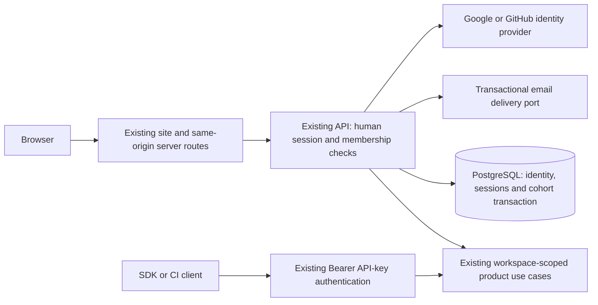

# ADR-036: Human identity, sessions and bounded beta admission

**Status:** Accepted for implementation by the owner, 2026-10-29
(TI-DELIVERY-001). This is not deployment or participant-admission approval.

Owner decision: "Accept ADR-036 for implementation (recommended)" in response
to the native-backend identity and thirty-account admission proposal.

## Context

The owner requested a self-service beta with Google, GitHub and email login,
at most thirty admitted participant accounts, private workspaces and a waitlist.
ADR-010 deliberately separates human login from machine API keys. The product
model already requires a User, but only fixture workspace provisioning exists.
The public site's current authentication and console are mocks.

The live owner-only service and Bearer-key SDKs must keep working. The current
code is a Kotlin modular monolith over PostgreSQL; the existing estate IdP is
used by nkama. Reusing that realm would add a product dependency on a different
application's identity configuration and recovery lifecycle. Thirty accounts
do not justify another service, datastore or a new role hierarchy.

This proposal extends ADR-010's separately scoped human-login concern. It
does not change SMTP replies, storage enforcement, existing API-key scope
ceilings, the promotion process or any unaccepted SDK distribution ADR.

## Decision

### 1. Identity belongs to the existing backend

Use the existing API deployable and PostgreSQL for human identity, membership,
revocable sessions and admission. Use the Spring Security OAuth2/OIDC client
managed by the existing Spring Boot dependency platform for provider protocol
validation; do not implement token signature validation or OAuth exchange
from scratch. Email verification is an application use case behind a delivery
port. Domain and application stay framework-free under ADR-024.

The GitLab Next.js console is the user-facing application. Its same-origin
server routes forward the account flow to the backend. The monorepo Inspector
remains a separate API-key tool. Do not create two human identity authorities
or turn a browser's JSON sessionStorage value into authentication.

An application flag disables the new account flow by default. Disabled or
incompletely configured deployed environments must never fall back to mock
login, a test OTP, a fixture account or an automatically privileged user.
The existing `/v1` Bearer API and production synthetic remain operational.

### 2. Identity is not an email match

- Google identity is its validated issuer and immutable subject. GitHub
  identity is its stable provider user ID, not its mutable login name.
- Request only identity/email scopes, no repository, Gmail, offline or cloud
  permissions. Discard provider access tokens after the identity operation;
  never use a provider token as a TestInbox session.
- Require a verified contact email before admission. Where the provider cannot
  supply suitable proof, complete TestInbox email verification first.
- Do not strip Gmail dots or plus suffixes, or infer that two provider accounts
  belong to one person from email text. A collision asks the user to authenticate
  to the existing account; it cannot create another workspace or merge it.
- For this first release, provider linking may remain unavailable rather than
  implementing implicit linking. A future link operation needs an existing
  authenticated session and fresh proof of the provider being linked.
- No human can create a workspace or issue keys merely by editing an email,
  account ID, workspace ID or scope in the browser.

### 3. Email login and sessions

Use an eight-digit email code, ten-minute expiry and at most five failed
verification attempts per challenge. Resending replaces the usable challenge;
successful consumption is atomic and single-use. Store a keyed verifier, not
the code or an offline-brute-forceable plain hash of an eight-digit value.
Keep the verification key outside the database in deployment secrets.

Bind the challenge to the browser's login attempt to prevent login CSRF.
Return generic request/verification responses where appropriate to prevent
account enumeration. Bound requests by verified deployment source, recipient
and a global sending budget; bound transient table cardinality and clean up
expired records. A successful HTTP request is not proof an email was sent:
delivery failure must be observable without leaking the address or code.

Use opaque random sessions in Secure, HttpOnly, host-only SameSite cookies.
Store session verifiers server-side, never plaintext session values in backups
or browser-accessible storage. Proposed session limits: seven-day absolute
lifetime and twenty-four-hour idle lifetime. Rotate at authentication; revoke
on logout, suspension and deletion. Recheck account/membership on each
authorized operation rather than caching a revoked account's authority.

The same-origin proxy preserves the cookie and response semantics, including
multiple Set-Cookie headers. Mutations require CSRF protection and exact origin
checks. Canonical callback/origin configuration is explicit; do not derive it
from an arbitrary Host or forwarded header. Account responses use no-store.

### 4. One transaction admits a participant

Human authentication and beta admission are separate states. An authenticated
but unadmitted account may inspect its own admission status and join or leave
the waitlist, but cannot create inboxes, receive credentials or access a tenant.

Admission runs through one application use case in one database transaction:

1. Resolve the verified account; reject suspended/deletion-pending identities.
2. Lock the cohort policy row. Recheck whether this account already has an
   admission and return the same result on retry.
3. Require admissions open, the fixed cap of thirty not exhausted, and the
   configured cohort/workspace budget to have capacity. Capacity policy must
   be available, not guessed from OFF-mode storage observations.
4. Claim a unique numbered place, create one workspace and project, and link
   the account membership. All commit together or none do.

Database constraints enforce unique cohort place, unique account admission,
unique participant workspace and one owner membership. The cap is independent
of API nodes and provider choice. Login callbacks can be retried safely; a
failed email delivery, unverified account or partial provisioning never spends
a place. A callback cannot resurrect a suspended or deleted membership.

The existing operational workspace is outside the thirty participant places.
Linking identities never creates a second place. No self-service second
workspace or team membership exists in this release. Deletion/suspension does
not automatically reopen a place; retain a non-identifying consumed-place
record rather than retaining deleted identity data merely to count admissions.
Any replacement admission is an explicit reviewed owner action.

### 5. Waitlist and owner controls

Joining the waitlist is explicit. It grants no workspace or session authority
over product data. Verify its contact address and enforce a configured global
entry bound, request/sending budget and an actual retention/withdrawal path.
Do not build an unlimited signup table behind a thirty-person product cap.

Provide operator controls to pause admissions and suspend/revoke an account.
These are not public request fields or hidden frontend buttons; their
authorization, effects on sessions/keys and metadata-only audit evidence are
part of the contract and tests. No application control can raise the cap
without a separate explicit owner decision.

### 6. Human workspace authority and API credentials

The backend resolves a human's authorized workspace from live membership.
The frontend supplies no trusted tenant identity. Reuse the existing
application use cases and repository scoping; do not synthesize a fake
administrator API-key principal or persist a real API key as the web session.

Credential issuance remains one application use case with provenance and scope
checks. Extend its actor model explicitly for an authorized workspace owner;
do not add a second minter or bypass the ADR-032 architecture guard. Issued
API keys retain their existing format, verifier-only persistence, show-once
response and immediate revocation behavior. They remain usable in SDK/CI
clients independently of a browser login.

Suspension/deletion must also block the workspace's machine credentials and
ingestion according to a documented policy; revoking only browser sessions
would leave an account active through its API keys and known recipient addresses.
Do not alter the uniform SMTP acceptance/discard contract.

### 7. Data lifecycle and release separation

Classify all new tables in `deploy/backup/scope.txt`. Identity, membership and
admission are control-plane state; transient session/challenge/provider state
must not enter the off-host backup. Decide the waitlist classification and
retention explicitly. Migrations remain expand-only and safe to roll back at
the artifact level. Restoring a backup must not resurrect deleted accounts or
previously invalidated access; design and test that recovery procedure.

Keep the thirty-account cohort bound explicit when revisiting ADR-027's
organization ceiling and ADR-033's idempotency-flow bound. Include new personal
data and deletion/restore behavior in the ADR-034 backup analysis and notices.

This decision alone does not resolve ADR-035 tenant fairness, footprint shares
or public capacity-disclosure policy. Production refuses TENANT_LIMITS/ALL
today. No signup activation may bypass that gate or advertise an OFF-mode
payload number as an enforced ingest allowance. A separate scoped policy and
test set must establish the cohort's effective resource protection before
third-party access; existing D3 host qualification is reused.

## Threat boundaries and required evidence

| Boundary / abuse case | Required proof |
|---|---|
| Forged provider identity, wrong issuer/audience, stale state/nonce or callback replay | Provider protocol tests; callback and CSRF negative tests; no account/admission side effect |
| Private/unverified GitHub email, Google non-authoritative contact email, matching email on another provider | Explicit verification and collision flow; no takeover or duplicate workspace |
| Concurrent applicants for the last place; replay after commit; provisioning failure | Real PostgreSQL barrier/latch tests: at most thirty places; same account returns its original workspace; rollback spends no place |
| Browser-supplied workspace, project, key scope or user ID | Cross-workspace HTTP/download/event tests and application authorization tests |
| Email-code guess/replay/race, send flood, unbounded waitlist | Atomic attempt/consumption tests and global/per-recipient/cardinality bounds |
| Stolen/old cookie, logout, suspension, deletion and restore | Immediate session/membership/key refusal, no invalidated access resurrected by recovery |
| Browser proxy, cookies, Host and Origin | Secure cookie, multiple Set-Cookie, CSRF, exact public origin, no-store and secret-leak tests |
| Unavailable OAuth/email provider or disabled/incomplete setup | Fail closed; existing Bearer API, ingestion and synthetics stay operational |

## Alternatives and trade-offs

| Option | Benefit | Cost / reason not preferred for this beta |
|---|---|---|
| Native identity in existing backend with maintained protocol libraries (recommended) | Same tenant authority and recovery process; no extra service/vendor; reusable existing DB and architecture | We own session, verification, abuse and account-lifecycle correctness and must test them |
| Separate TestInbox Keycloak realm | Central maintained provider/session implementation; estate familiarity | New live realm/flows/email setup; coupling to IdP availability, upgrades and recovery; app still needs admission/membership enforcement |
| External identity provider | Offloads identity maintenance | New provider, privacy/region/cost decision and integration; does not remove local cohort/tenant controls |
| Authentication solely in Next.js | Fits existing visual flows | Splits identity/admission authority across repositories; still needs a secure backend membership contract; not a shortcut to workspace isolation |

## Acceptance and implementation boundary

The owner accepted this implementation architecture on 2026-10-29. This
authorizes local implementation and verification, not live credentials,
production promotion, public registration or storage-enforcement activation.

Write the account API contract and actor-model diff before their
implementation in the same feature change. Save each tested milestone
with its actual evidence in `docs/delivery/ti-delivery-001/STATUS.md`.

## Primary references checked for this proposal

- [Spring Security OAuth2 Login](https://docs.spring.io/spring-security/reference/servlet/oauth2/login/core.html)
- [Google OpenID Connect](https://developers.google.com/identity/openid-connect/openid-connect)
- [GitHub authorization-code flow](https://docs.github.com/en/apps/oauth-apps/building-oauth-apps/authorizing-oauth-apps)
- [GitHub email verification fields](https://docs.github.com/en/rest/users/emails)
